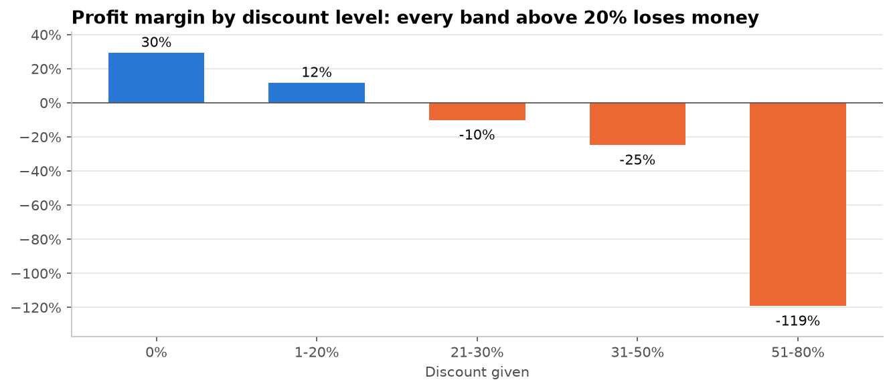
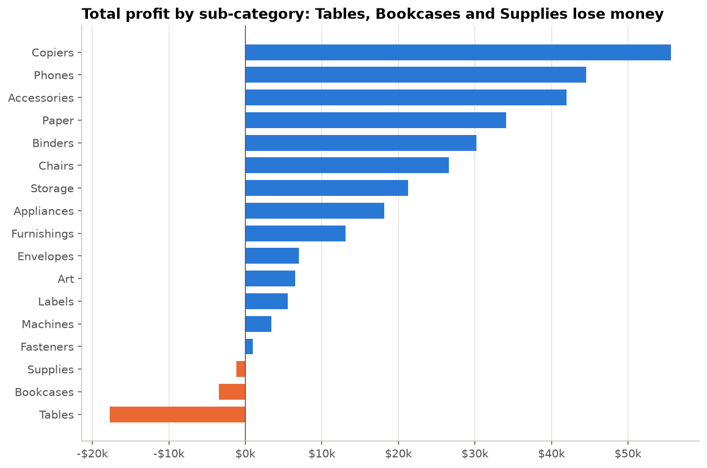
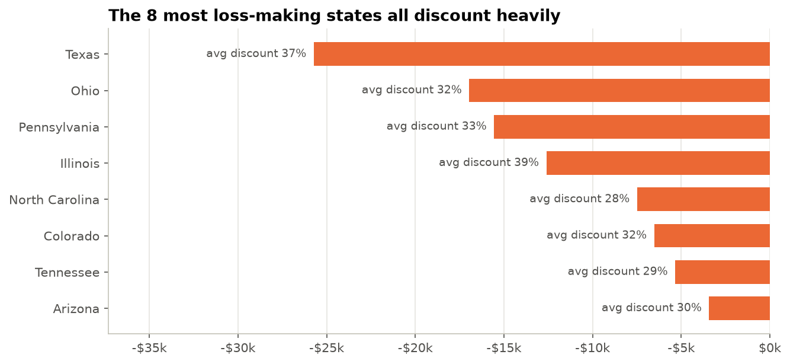
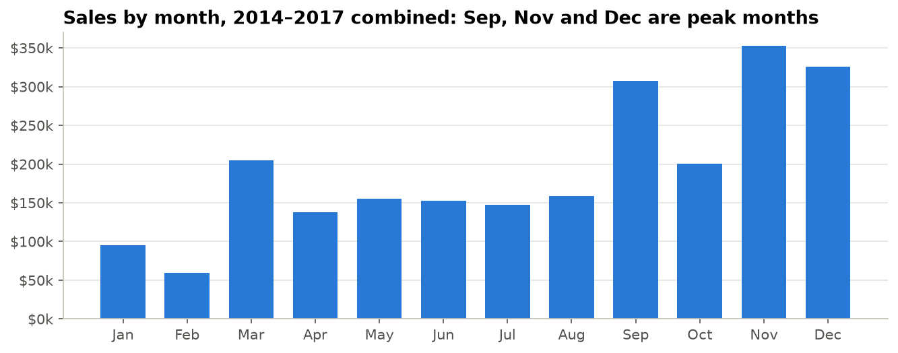

# Retail Profitability Analysis: Where Is the Profit Leaking?

**SQL (DuckDB) · Python (pandas, matplotlib) · Power BI**

A US office-supplies retailer grew sales by **51% between 2014 and 2017**, but its profit margin stayed stuck at about 12–13% and fell in 2017. This project finds out why and recommends what to change.

> **Key finding:** every order line discounted by more than 20% loses money on average. They are only 14% of order lines, but they wipe out **$135k** of profit. Capping discounts at 20% would raise profit by an estimated **+47% to +77%**.

---

## Business questions

| # | Question | Answer in one line |
|---|---|---|
| 1 | How have sales, profit and margin trended? | Sales +51% in 3 years, margin flat at ~12.5% and down in 2017 |
| 2 | Which products lose money? | Tables (−$17.7k), Bookcases and Supplies. Furniture margin is only 2.5% |
| 3 | At what discount does a sale become unprofitable? | **Above 20%**: over 90% of those lines lose money |
| 4 | Which regions and states drain profit? | Central region. Texas, Ohio, Pennsylvania and Illinois lose ~$71k combined |
| 5 | Which customer segment is most valuable? | Home Office: $66 profit per order vs $52 for Consumer |
| 6 | What if discounts were capped at 20%? | **+$135k to +$219k profit** |

## Results

### Discounting above 20% destroys margin


### Three sub-categories lose money, led by Tables


### The most loss-making states all discount heavily


### Strong Q4 seasonality: Sep, Nov and Dec bring in ~43% of revenue


## Recommendations

1. **Cap standard discounts at 20%.** Anything deeper needs approval and a margin check.
2. **Re-price Furniture**, starting with Tables and Bookcases. Cut discounts or renegotiate supplier costs.
3. **Pilot the cap in Texas, Ohio, Pennsylvania and Illinois** before rolling it out company-wide.
4. **Prioritise Home Office customers and Technology products**, which have the best profit per order and the best margins.
5. **Plan stock and promotions for Q4** without relying on deep discounts.

**Scenario assumptions:** product cost is unchanged. The *worst case* assumes every deep-discount customer walks away. The *best case* assumes they still buy at 20% off. The true effect sits between the two and should be measured with a regional pilot.

---

## Approach

```
Raw CSV ──► 01 Data quality & cleaning (SQL) ──► clean CSV ──► 02 Analysis (SQL + Python) ──► Findings
                                                     │
                                                     └──► Power BI dashboard
```

### 1. Data quality: problems found and fixed
| Issue | How it was found | Fix |
|---|---|---|
| **Two date formats in one column** (`4/15/2017` and `11-08-2016`, ~40% of rows) | Grouped dates by separator | Standardised and parsed month-first. **Validated** by checking that every shipment leaves 0–7 days after the order |
| One exact duplicate order line | `GROUP BY` on every column except Row ID | Removed with `ROW_NUMBER()` |
| Row ID looked non-unique (`approx_unique` ≈ 9,400) | `SUMMARIZE` profile | Exact `COUNT(DISTINCT)` showed it was an estimate. No issue |
| Constant `Country` column | Column profile | Dropped |

Derived fields added: `ship_days`, `order_year`, `order_month`, `discount_band`, `is_loss`, `list_price_sales`.

### 2. SQL techniques used
CTEs · window functions (`LAG`, `RANK`, `ROW_NUMBER`) · `CASE` banding · `HAVING` · scenario modelling in SQL. The key queries are in [`sql/analysis_queries.sql`](sql/analysis_queries.sql).

### 3. Dashboard
An interactive Power BI report with KPI cards, trend, profit by sub-category, margin by discount band, a state map and a **what-if slider for the discount cap**. Build steps and DAX measures are in [`dashboard/POWERBI_GUIDE.md`](dashboard/POWERBI_GUIDE.md).

## Repository structure
```
├── data/
│   ├── raw/                  # original Kaggle file (not committed)
│   └── processed/            # superstore_clean.csv
├── notebooks/
│   ├── 01_data_quality_and_cleaning.ipynb
│   └── 02_profitability_analysis.ipynb
├── sql/analysis_queries.sql
├── dashboard/                # Power BI report + guide
├── images/                   # charts used in this README
└── requirements.txt
```

## How to run
```bash
python -m venv venv
venv\Scripts\activate          # Windows  (macOS/Linux: source venv/bin/activate)
pip install -r requirements.txt
```
1. Download `Sample - Superstore` from [Kaggle](https://www.kaggle.com/datasets/naveenkumar20bps1137/sample-superstore) and save it as `data/raw/superstore.csv`.
2. Run `notebooks/01_data_quality_and_cleaning.ipynb`, then `02_profitability_analysis.ipynb`.

## Data
Sample Superstore: 9,994 order lines, 2014–2017, US retail (Furniture, Office Supplies, Technology). Values are in USD. This is a public teaching dataset, used here to show an end-to-end analytical workflow.
